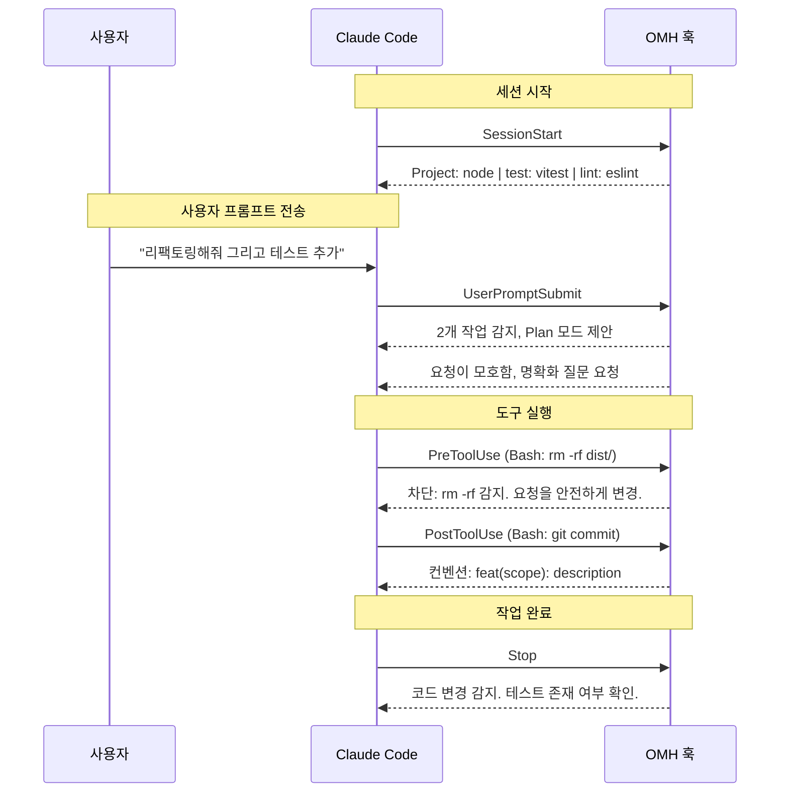
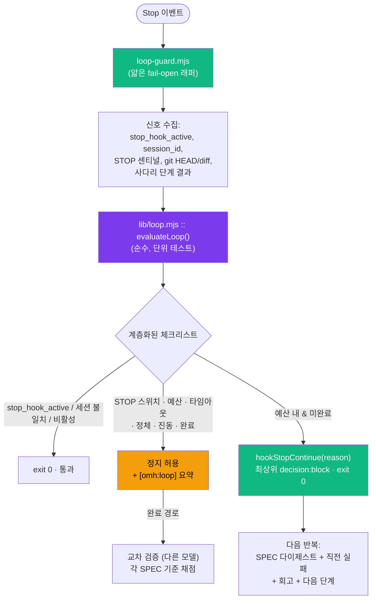

# 아키텍처

OMH는 네이티브 **Claude Code 또는 Codex 플러그인**(권장), 또는 **로컬 CLI**로 설치합니다. 모든 모드는 동일한 코어 판단을 사용하며 네이티브 훅 계약, 스킬, 역할 지침, 등록 위치만 다릅니다.

## Codex 지원

OMH는 런타임 중립 공유 코어와 네이티브 adapter를 사용합니다. 기존 `.claude-plugin` 패키지와 Claude hooks는 그대로 유지되고, [`.codex-plugin/plugin.json`](../.codex-plugin/plugin.json)은 Codex가 `codex/skills/`, `.mcp.json`, `hooks/codex/hooks.json`을 사용하도록 연결합니다. Bridge는 `hooks/codex/adapter.mjs`와 sequential orchestrator `hooks/codex/run.mjs`입니다. Marketplace 설치가 번들하는 것은 이 skills, hooks, MCP뿐입니다. 커스텀 Codex 역할 프로필과 지속 `AGENTS.md` 지침은 번들된 `/harness-setup` 또는 `oh-my-harness init --runtime codex|both`가 필요합니다.

런타임별 등록은 분리되지만 프로젝트 상태는 분리되지 않습니다. 두 런타임은 `.claude/.omh/harness.config.json`, `STATE.md`, `loop-state.json`, 학습, 컨벤션, 사용량을 함께 읽습니다. `~/.omh/memory/graph.jsonl`도 공유합니다. 이번 호환성 릴리스에서 `.claude/.omh/`를 유지해 상태 마이그레이션을 피합니다.

| 계약 | Claude Code | Codex |
|---|---|---|
| 컨텍스트 주입 | Claude 훅 출력 | `hookSpecificOutput.additionalContext` |
| 도구 실행 전 거부 | Claude 권한 계약 | `hookSpecificOutput.permissionDecision = "deny"` |
| Stop 연속 실행 | 최상위 `decision: "block"` | 동일한 최상위 연속 실행 형태 |
| fail-open 성공 | 종료 코드 0 | 출력 없이 종료 코드 0 |

공식 Codex sibling hook handler는 concurrent입니다. OMH는 대신 이벤트마다 **one orchestrator**를 등록하고 공유 handler를 **sequential**하게 실행합니다. Critical `PreToolUse` guard는 실행/출력으로 안전을 확인할 수 없으면 fail closed이고 advisory 관측 hook은 경고하거나 계속하며 fail open입니다. Codex hook 신뢰는 네이티브 경계를 유지하며 `/hooks`에서 검토해야 합니다.

## 계층 구조

OMH는 네 개의 계층으로 구성됩니다. 판단 로직은 순수하고 단위 테스트된 코어 모듈에 두고 각 native adapter가 이벤트의 안전 정책을 적용합니다. 이 분리 덕분에 핵심 로직을 라이브 세션 없이 테스트할 수 있습니다.

| 계층 | 구성 요소 | 역할 |
|------|-----------|------|
| **① 훅** | Codex 이벤트 orchestrator 6개 뒤의 공유 스크립트 11개, Codex 브리지 모듈 2개 | 이벤트마다 one orchestrator, sequential 공유 handler, critical guard fail closed, advisory hook fail open. silent가 아닌 모든 출력은 Decision Log에 기록 |
| **② 코어** | 순수 판단: `lib/loop.mjs`, `risk.mjs`, `plan-gate.mjs`, `profiles.mjs`, `failure-format.mjs`, `tier-metrics.mjs`, `hooks/lib/tier.mjs`, `dictionary.mjs`. fail-open I/O 헬퍼: `config.mjs`, `detect.mjs`, `state.mjs`, `decision-log.mjs`, `session-health.mjs`, `claude-md.mjs`, `docs-sync.mjs`, `verify.mjs`, `hooks/lib/state-io.mjs` | 판단 로직은 **순수 함수**(fs / git / `Date.now` / child_process 없음)로 두고 단위 테스트; I/O 헬퍼는 실패해도 hook 결과를 바꾸지 않음 |
| **③ 스킬** | Claude 스킬 15개 (`claude/skills/`) / Codex 스킬 16개 (`codex/skills/`) | 사용자 호출 워크플로우: 설정, 에이전트, 팀, 스펙 / 루프 / 검증 / 핸드오프 / 문서 동기화 / Codex 상태. 각 `SKILL.md`는 4KB 이하이고 세부 내용은 `references/`에 둠 |
| **④ 에이전트** | `quick` / `standard` / `architect` (`agents/`) | 모델 라우팅 — 작업 무게에 따라 haiku / sonnet / opus |

생명주기 이벤트는 순서가 있는 여러 훅을 실행할 수 있습니다. `PreToolUse`, `PostToolUse`, `Stop`은 의도적으로 둘 이상을 실행하며, 자율 루프는 `Stop` 체인에 있습니다:

| 생명주기 이벤트 | 훅 | 동작 |
|-----------------|-----|------|
| `SessionStart` | `session-start.mjs` | 컨벤션 감지, `STATE.md` 주입 (사용자가 쓴 줄 먼저, 이어서 스냅샷) |
| `UserPromptSubmit` | `pre-prompt.mjs` | 무게 티어와 `!t1`/`!t3`/`!noplan` override, 모호성 가드, 자동 Plan, 플랜 게이트 무장, 핸드오프 제안 |
| `PreToolUse` | `dangerous-guard.mjs` · **`plan-gate.mjs`** · `scope-guard` (Codex) | 파괴적 작업 또는 malformed hook 입력 차단 · 플랜 게이트 · Codex 스코프 집행 |
| `PostToolUse` | `commit-convention` · `scope-guard` (Claude) · `usage-tracker` | 커밋 형식 · Claude 스코프 보고 · 사용량 통계 |
| `PreCompact` | `pre-compact.mjs` | 압축 횟수 기록, `STATE.md` 스냅샷 재생성, 컨텍스트 스냅샷 |
| `Stop` | **`loop-guard.mjs`** · **`verify-gate.mjs`** · `post-task.mjs` | 자율 루프 엔진, 위험도 기반 검증 게이트, `STATE.md` 스냅샷과 테스트 강제 |

아래 다이어그램은 이 계층들이 설정과 디스크 데이터에 어떻게 연결되는지를 보여줍니다.

Stop 훅 게이트는 **두 개**입니다: `loop-guard.mjs`는 활성 `/omh-loop` 안에서 검증을 소유하고, `verify-gate.mjs`는 평범한 세션에서 소유합니다(루프가 활성이면 비켜남). 둘 다 동일한 최상위 `{decision:'block'}` 계약으로 계속을 강제합니다.

Tier 3 Plan Gate의 네이티브 신호는 런타임별로 다릅니다. Claude는 `Edit`/`Write`/`NotebookEdit`/`MultiEdit`를 막고 `ExitPlanMode`로 해제합니다. Codex는 `apply_patch`를 edit로 매핑하고, 비어 있지 않으며 각 항목의 `step`이 비어 있지 않고 `status`가 허용 값인 `update_plan`만 공유 해제 신호로 매핑합니다. 그 밖의 payload는 해제하지 않으며 denial 상한은 non-wedging fallback으로 남습니다.

스코프 배치도 런타임마다 다릅니다. **Codex PreToolUse**는 실행 전에 세 번째 critical 단계로 스코프 가드를 수행하고, **Claude PostToolUse**는 기존 observer 등록을 유지합니다. Codex가 스코프 설정을 읽지 못하면 프로젝트 경계를 fallback allowlist로 삼고 그 밖으로 나가는 traversal을 차단합니다.

## 개요

```mermaid
graph TB
    subgraph "Claude Code 세션"
        direction TB
        CC[Claude Code] --> HOOKS[훅 시스템]
        CC --> SKILLS[스킬 시스템]
        CC --> AGENTS[에이전트 시스템]
    end

    subgraph "Oh My Harness"
        direction TB
        HOOKS --> H1[session-start.mjs]
        HOOKS --> H2[pre-prompt.mjs]
        HOOKS --> H3[dangerous-guard.mjs]
        HOOKS --> H4[commit-convention.mjs]
        HOOKS --> H5[scope-guard.mjs]
        HOOKS --> H6[usage-tracker.mjs]
        HOOKS --> H7[pre-compact.mjs]
        HOOKS --> H9["loop-guard.mjs (Stop, 루프 엔진)"]
        HOOKS --> H8[post-task.mjs]
        HOOKS --> DLOG["lib/decision-log.mjs (silent 아닌 모든 출력)"]

        SKILLS --> S1["/harness-setup"]
        SKILLS --> S2["/omh-verify"]
        SKILLS --> S3["/agent-spawn"]
        SKILLS --> S4["/agent-status"]
        SKILLS --> S5["/omh-spec"]
        SKILLS --> S6["/omh-loop"]
        SKILLS --> S7["/team-spawn"]
        SKILLS --> S8["/omh-handoff"]

        AGENTS --> A1["harness:quick (haiku)"]
        AGENTS --> A2["harness:standard (sonnet)"]
        AGENTS --> A3["harness:architect (opus)"]

        H9 --> LOOPLIB["lib/loop.mjs (순수 결정 로직)"]
    end

    subgraph "설정 (프로젝트 → ~/.claude 전역 fallback)"
        CONFIG[harness.config.json]
    end

    subgraph "프로젝트 데이터 (.claude/.omh/)"
        CONV[conventions.json]
        USAGE[usage.json]
        SNAP[context-snapshot.md]
        STATE[STATE.md]
        LSTATE[loop-state.json]
        LEARN[loop-learnings.md]
        DEC[decisions.jsonl]
        HEALTH[session-health.json]
        HAND[HANDOFF.md]
    end

    PROGRESS["PROGRESS.md (프로젝트 루트 · 사람용 로그)"]

    H1 --> CONV
    H6 --> USAGE
    H7 --> SNAP
    H1 --> STATE
    H7 --> STATE
    H8 --> STATE
    H2 --> HEALTH
    H7 --> HEALTH
    DLOG --> DEC
    S8 --> HAND
    H1 --> CONFIG
    H2 --> CONFIG
    H3 --> CONFIG
    H9 --> CONFIG
    H9 --> LSTATE
    H9 --> LEARN
    S6 --> PROGRESS

    style CC fill:#7C3AED,color:#fff
    style CONFIG fill:#f59e0b,color:#000
    style H9 fill:#10b981,color:#fff
    style LSTATE fill:#f59e0b,color:#000
```



## 훅 파이프라인



## 자율 루프 (Stop 훅)

`/omh-loop`은 **Stop** 이벤트를 스펙 기반 자율 루프로 바꿉니다. Stop 훅 `loop-guard.mjs`가 **루프 엔진 그 자체**입니다 — 매 Stop마다 계속 진행을 강제할지, 세션을 멈추게 둘지 결정합니다. 계속 진행은 stdout에 **최상위(top-level)** `{"decision":"block","reason":...}`를 출력하고 `0`으로 종료해서 강제합니다(exit 2 사용 금지, `hookSpecificOutput` 아래 중첩 금지). 루프가 완료됐거나 가드레일이 발동하면 조용히 통과(passthrough)시켜 정지를 허용합니다.

결정 로직은 순수하고 단위 테스트된 `lib/loop.mjs`에 있습니다(`evaluateLoop`, `classifyTier`, `buildLadder`, `detectPlateau`, `detectOscillation`). 훅은 **얇은 fail-open 래퍼**입니다: 신호(git HEAD/diff, 사다리 단계 결과, `stop_hook_active`, `session_id`, STOP 센티널)를 모아 `evaluateLoop`를 호출하고 결과를 내보냅니다. 오류나 상태 손상 시 상태를 삭제하고 `0`으로 종료하여 사용자를 절대 가두지 않습니다. 언제 계속하고 언제 멈출지는 모델의 자기 평가가 아니라 **하니스가** 소유합니다.



루프는 **계층(tier)** 구조이며(`quick` / `standard` / `deep`가 반복 횟수·벽시계 시간 예산과 검증 깊이를 정하고, 계층을 가로지르는 `maxTotalIterations` 상한이 있음), **저비용 우선 검증 사다리**(quickCheck → 선택적 contract → verify → self-review → cross-verify)를 실행합니다. 이 사다리는 빠르게 실패하고, 위치부터 보여주는 실패 보고(`lib/failure-format.mjs`: `file:line` 줄, 없으면 출력 끝의 에러 줄)를 다음 반복의 지시문으로 되먹입니다. 상태는 `.claude/.omh/loop-state.json`에 저장되며(원자적 쓰기, fail-open), 프로젝트 루트의 `PROGRESS.md`가 사람이 읽는 계획 + 로그이고, `.claude/.omh/loop-learnings.md`는 빌드/테스트 호출을 캐시합니다. 전체 `loop` 설정 블록은 [docs/loop](./loop.ko.md)과 [docs/configuration](./configuration.ko.md)을 참고하세요.

## 무게 라우팅 (UserPromptSubmit 훅)

`features.weightRouting`이 켜지면 `pre-prompt.mjs`가 작업 시작 전에 프롬프트를 Tier 1(가벼움), Tier 2(표준), Tier 3(무겁거나 위험함)으로 분류합니다. 순수 코어 `lib/tier.mjs`는 `lib/dictionary.mjs`의 한국어/영어 패턴과 설정된 도메인 키워드를 사용합니다. Tier 3은 완료 선언 전에 `/omh-verify`를 강제합니다. 훅은 티어를 `[omh:tier]` 태그(무거운 작업은 `[omh:tier-3]` 추가)로 내보냅니다. 프롬프트 앞의 `!t1` / `!t3`는 티어를 덮어쓰고, `!noplan`은 티어는 유지한 채 플랜 게이트를 무장하지 않습니다. 훅은 `[omh:override]`로 이를 알리고 기록합니다. 분류기 정확도는 CI에서 `test/fixtures/prompts.jsonl`(라벨 붙은 한/영 프롬프트 94개)과 `prompts.baseline.json`의 하한으로 측정합니다. 프로젝트 설정을 먼저 읽고 없으면 전역 `~/.claude/.omh` 설정으로 fallback합니다.

## 교차 모델 검증 (/omh-verify)

`/omh-verify`는 현재 diff에 대해 N회의 독립 다중 모델 검증+수정을 실행합니다. 각 라운드는 Claude, GPT(`codex`), Gemini 렌즈를 새 컨텍스트에서 교대합니다. 외부 검증자는 엄격한 읽기 전용입니다. `lib/adapters/codex.mjs`는 `codex exec -s read-only`, Gemini 어댑터는 `gemini -p --approval-mode plan`을 사용합니다. `lib/verify.mjs`가 diff 캡처, 렌즈 로테이션, 라운드 계산을 담당합니다.

## STATE.md — 살아있는 프로젝트 앵커

`lib/state.mjs`가 관리하는 `.claude/.omh/STATE.md`의 주인은 둘입니다. **Goal**과 **Key Decisions**는 사람(또는 요청받은 모델)이 관리합니다. `<!-- OMH:AUTO:START -->` … `<!-- OMH:AUTO:END -->` 블록은 hook이 관리하며, `post-task.mjs`(Stop)와 `pre-compact.mjs`(PreCompact)가 `syncAutoState()`로 기계적 출처만 써서 다시 생성합니다(브랜치, 최근 커밋 5개, 커밋 안 된 파일, `loop-state.json`, `verify-gate-state.json`). `session-start.mjs`는 사람이 쓴 줄을 먼저, 이어서 스냅샷을 넣고 1000자로 제한합니다. `.claude/.omh`가 이미 있을 때만 씁니다(`features.stateSync`, 기본 on). Claude Code와 Codex 훅과 스킬이 같은 파일을 공유합니다.

`lib/session-health.mjs`는 세션별 프롬프트 수와 압축 횟수를 `session-health.json`에 셉니다. 압축이 있었거나 `handoff.promptThreshold`를 넘으면 `pre-prompt.mjs`가 세션당 한 번, 카운터가 저장된 경우에만 `[omh:handoff]`를 내보냅니다. `oh-my-harness handoff`와 `/omh-handoff`는 같은 스냅샷으로 `HANDOFF.md`를 만듭니다.

## Decision Log

`lib/decision-log.mjs`는 silent가 아닌 hook 출력마다 `.claude/.omh/decisions.jsonl`에 JSON 한 줄을 추가합니다. `hooks/lib/output.mjs`의 출력 헬퍼가 호출하므로 hook마다 코드를 넣지 않아도 모두 기록됩니다. `pre-prompt.mjs`는 `setDecisionMeta()`로 티어, 사유, override, 세션 id를 붙입니다. 프롬프트 원문은 저장하지 않습니다. 약 500줄로 잘리고, `OMH_DECISION_LOG=0`이면 꺼지며, 쓰기에 실패해도 hook 출력은 바뀌지 않습니다. `oh-my-harness why`가 이 파일을 읽고, `lib/profiles.mjs`가 기능 제안으로 바꿉니다.

## 플러그인 모드 (권장)

Claude Code는 `.claude-plugin`, `CLAUDE.md`, `hooks/hooks.json`, `claude/skills/`를 로드합니다. Codex marketplace manifest는 `.codex-plugin`, `codex/skills/`, Codex hooks, MCP를 로드합니다. Additive discovery가 런타임 variant를 중복 노출하지 않도록 기본 root `skills/`는 의도적으로 두지 않습니다. Marketplace는 역할 프로필이나 지속 `AGENTS.md` 지침을 설치하지 않으며, 그 등록 표면은 확인된 `/harness-setup` 또는 직접 로컬 CLI init만 추가합니다.

메모리 MCP는 **plugin root**에서 `bin/omh-memory.sh`를 실행하고, launcher는 `npx --yes --prefer-offline @modelcontextprotocol/server-memory@2026.7.4`를 호출합니다. 처음 uncached 실행은 npm registry/network 접근이 필요하며 release 검증은 macOS 현재 머신 cache를 warm합니다. Native Windows Codex hooks에는 `commandWindows`가 있지만 MCP launcher에는 Bash가 필요합니다.

```
oh-my-harness/                    <- 플러그인 루트 ($CLAUDE_PLUGIN_ROOT)
├── .claude-plugin/
│   ├── plugin.json               <- 플러그인 매니페스트
│   └── marketplace.json          <- 마켓플레이스 목록
├── .codex-plugin/plugin.json     <- Codex 플러그인 매니페스트
├── CLAUDE.md                     <- 시스템 프롬프트 (자동 주입)
├── codex/                        <- Codex 네이티브 스킬, 역할, 지침
├── hooks/
│   ├── hooks.json                <- 훅 등록 ($CLAUDE_PLUGIN_ROOT 사용)
│   ├── lib/output.mjs            <- 공유 출력 헬퍼 (hookStopContinue 포함), 판정 기록
│   ├── lib/state-io.mjs          <- 원자적 JSON 상태 writer (OMH_TEST_FAIL_WRITE 주입)
│   ├── lib/dictionary.mjs        <- 한/영 패턴 + 무게 표현
│   ├── lib/tier.mjs              <- 작업 무게 분류기 (Tier 1/2/3) + 프롬프트 override
│   ├── lib/hook-config.mjs       <- config 로더 (프로젝트 → ~/.claude 전역 fallback)
│   ├── session-start.mjs         <- 컨벤션 감지 + STATE.md 주입
│   ├── pre-prompt.mjs            <- 모호성 + 자동 Plan + 무게 라우팅 + 핸드오프 제안
│   ├── dangerous-guard.mjs       <- 파괴적/malformed 요청 차단
│   ├── plan-gate.mjs             <- PreToolUse: 편집 전 Tier 3 플랜 강제
│   ├── commit-convention.mjs     <- 커밋 형식 안내
│   ├── scope-guard.mjs           <- Codex 실행 전 집행 / Claude 실행 후 보고
│   ├── usage-tracker.mjs         <- 도구 사용량 기록
│   ├── pre-compact.mjs           <- 컨텍스트 스냅샷 + STATE.md 스냅샷
│   ├── loop-guard.mjs            <- Stop 훅: 루프 엔진 + 안전장치 (lib/loop.mjs의 얇은 래퍼)
│   ├── verify-gate.mjs           <- Stop 훅: 평범한 세션의 위험도 기반 검증 사다리
│   └── post-task.mjs             <- 테스트 강제 + STATE.md 스냅샷
├── claude/skills/                <- Claude 스킬 15개 (커스텀 manifest 경로)
│   ├── harness-setup/            <- /harness-setup (SKILL.md + references/)
│   ├── set-harness/SKILL.md      <- /set-harness
│   ├── init-project/SKILL.md     <- /init-project
│   ├── omh-spec/SKILL.md         <- /omh-spec (SPEC.md 작성)
│   ├── omh-loop/                 <- /omh-loop (SKILL.md + references/iteration, cross-verify, memory)
│   ├── omh-verify/SKILL.md       <- /omh-verify (N-라운드 독립 검증)
│   ├── omh-handoff/SKILL.md      <- /omh-handoff (새 세션용 HANDOFF.md)
│   ├── omh-docs-sync/SKILL.md    <- /omh-docs-sync (opt-in pre-push hook에서 사용)
│   ├── agent-spawn/SKILL.md      <- /agent-spawn
│   ├── agent-status/SKILL.md     <- /agent-status
│   ├── agent-apply/SKILL.md      <- /agent-apply
│   ├── agent-stop/SKILL.md       <- /agent-stop
│   ├── team-spawn/SKILL.md       <- /team-spawn
│   ├── team-status/SKILL.md      <- /team-status
│   └── team-stop/SKILL.md        <- /team-stop
├── codex/skills/                 <- Codex 네이티브 스킬 16개 (커스텀 manifest 경로)
├── lib/                          <- 코어 모듈
│   ├── loop.mjs                  <- 루프 결정 로직 + 검증 사다리 (순수)
│   ├── risk.mjs                  <- 검증 게이트 위험도 판단 (순수)
│   ├── plan-gate.mjs             <- 플랜 게이트 판단 (순수)
│   ├── profiles.mjs              <- minimal/standard/full + 제안 (순수)
│   ├── failure-format.mjs        <- 위치 우선 실패 보고 (순수)
│   ├── tier-metrics.mjs          <- 분류기 코퍼스 지표 (순수)
│   ├── config.mjs                <- config 스키마 + deep-merge
│   ├── state.mjs                 <- STATE.md AUTO 블록 + HANDOFF.md
│   ├── decision-log.mjs          <- decisions.jsonl 읽기/쓰기/요약
│   ├── session-health.mjs        <- 핸드오프 제안용 프롬프트/압축 카운터
│   ├── claude-md.mjs             <- 생성되는 CLAUDE.md 하네스 블록
│   ├── docs-sync.mjs             <- opt-in pre-push hook 설치/제거
│   ├── verify.mjs                <- /omh-verify 헬퍼 (diff, 렌즈 로테이션)
│   └── adapters/
│       ├── codex.mjs             <- GPT 검증자 (codex exec -s read-only)
│       └── gemini.mjs            <- Gemini 검증자 (gemini -p --approval-mode plan)
└── agents/                       <- 모델 라우팅 에이전트
    ├── quick.md                   <- haiku
    ├── standard.md                <- sonnet
    └── architect.md               <- opus
```

## 로컬 CLI 모드

클론한 저장소에서 실행합니다(`node bin/cli.mjs init`, 또는 `npm link`로 `oh-my-harness` 단축 명령 등록). 기본값은 `.claude/`에 설치하는 Claude 프로젝트 모드입니다. `.codex/`, `.agents/skills/`, `AGENTS.md`에는 `--runtime codex`, 두 등록 모두에는 `--runtime both`를 사용합니다:

```
your-project/
└── .claude/
    ├── settings.local.json       <- 훅 등록
    ├── CLAUDE.md                 <- 행동 규칙 추가
    ├── commands/                 <- CLI가 설치하는 슬래시 명령어 6개 (나머지 스킬은 플러그인에 포함)
    │   ├── set-harness.md
    │   ├── init-project.md
    │   ├── agent-spawn.md
    │   ├── agent-status.md
    │   ├── agent-apply.md
    │   └── agent-stop.md
    ├── PROGRESS.md               <- 루프 계획 + 사람용 로그 (프로젝트 루트)
    └── .omh/                     <- 프로젝트 데이터 (gitignored)
        ├── harness.config.json
        ├── conventions.json
        ├── usage.json
        ├── context-snapshot.md
        ├── STATE.md              <- Goal/Decisions + 자동 생성 OMH:AUTO 스냅샷
        ├── decisions.jsonl       <- Decision Log (`oh-my-harness why`가 읽음)
        ├── session-health.json   <- 프롬프트/압축 카운터 (핸드오프 제안)
        ├── HANDOFF.md            <- `oh-my-harness handoff` / `/omh-handoff`가 작성
        ├── loop-state.json       <- 루프 엔진 상태 (원자적 쓰기, fail-open)
        ├── loop-learnings.md     <- 캐시된 빌드/테스트 호출
        └── STOP                  <- 킬 스위치 (존재할 때)
```

> 참고: `PROGRESS.md`는 `.claude/` 아래가 아니라 **프로젝트 루트**에 위치합니다. 여기서는 루프 데이터와의 근접성을 위해 CLI 레이아웃 옆에 표시했습니다.
