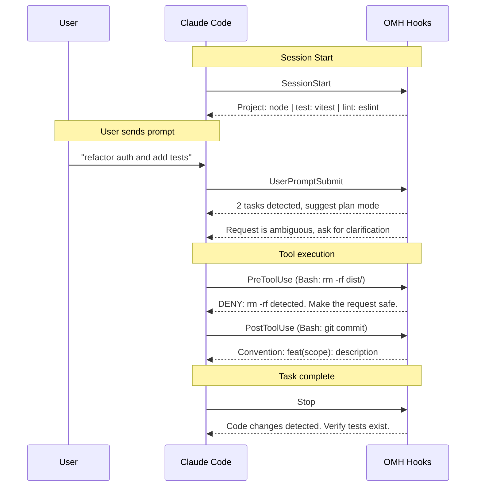
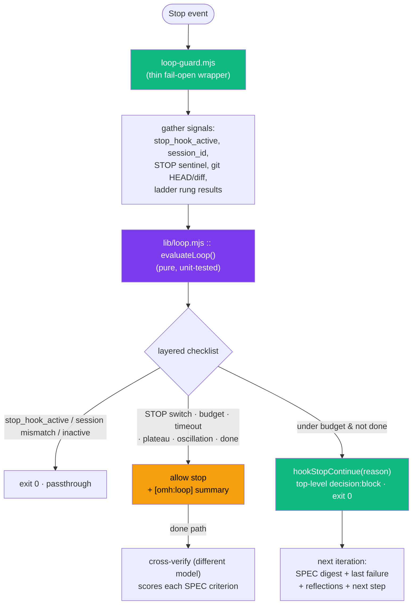

# Architecture

OMH installs as a native **Claude Code or Codex plugin** (recommended), or through the **local CLI**. Every mode uses the same core decisions; only native hook contracts, skills, role guidance, and registration destinations differ.

## Codex Support

OMH uses a shared runtime-neutral core with native adapters. The existing `.claude-plugin` package and Claude hooks remain intact; [`.codex-plugin/plugin.json`](../.codex-plugin/plugin.json) points Codex at `codex/skills/`, `.mcp.json`, and `hooks/codex/hooks.json`. The bridge is `hooks/codex/adapter.mjs` plus the sequential `hooks/codex/run.mjs` orchestrator. Marketplace installation bundles those skills, hooks, and MCP only. Custom Codex role profiles and durable `AGENTS.md` guidance require the bundled `/harness-setup` flow or `oh-my-harness init --runtime codex|both`.

Runtime-specific registrations remain separate, but project state does not. Both runtimes read `.claude/.omh/harness.config.json`, `STATE.md`, `loop-state.json`, learnings, conventions, and usage. They also share `~/.omh/memory/graph.jsonl`. Retaining `.claude/.omh/` avoids a state migration in this compatibility release.

| Contract | Claude Code | Codex |
|---|---|---|
| Context injection | Claude hook output | `hookSpecificOutput.additionalContext` |
| Pre-tool denial | Claude permission contract | `hookSpecificOutput.permissionDecision = "deny"` |
| Stop continuation | Top-level `decision: "block"` | The same top-level continuation shape |
| Fail-open success | Exit zero | Exit zero with no output |

Official Codex sibling hook handlers are concurrent. OMH instead registers **one orchestrator** per event, and that orchestrator runs the shared handlers **sequentially**. Critical `PreToolUse` guards fail closed if execution or output cannot establish safety; advisory observation hooks warn or continue and fail open. Codex hook trust remains native and must be reviewed in `/hooks`.

## Layers

OMH is built in four layers. The design rule keeps decision logic in pure, unit-tested core modules while each native adapter applies the event's safety policy. That separation makes load-bearing logic testable without a live session.

| Layer | Components | Role |
|-------|-----------|------|
| **① Hooks** | 11 shared scripts behind 6 Codex event orchestrators; Codex adds 2 bridge modules | One orchestrator per event, sequential shared handlers, fail closed critical guards, fail-open advisory hooks. Every non-silent output is recorded in the Decision Log |
| **② Core** | Pure decisions: `lib/loop.mjs`, `risk.mjs`, `plan-gate.mjs`, `profiles.mjs`, `failure-format.mjs`, `tier-metrics.mjs`, `hooks/lib/tier.mjs`, `dictionary.mjs`. Fail-open I/O helpers: `config.mjs`, `detect.mjs`, `state.mjs`, `decision-log.mjs`, `session-health.mjs`, `claude-md.mjs`, `docs-sync.mjs`, `verify.mjs`, `hooks/lib/state-io.mjs` | Decision logic as **pure functions** (no fs / git / `Date.now` / child_process) → fully unit-tested; I/O helpers never change a hook's result when they fail |
| **③ Skills** | 15 Claude skills (`claude/skills/`) / 16 Codex skills (`codex/skills/`) | User-invoked workflows: setup, agents, teams, spec / loop / verify / handoff / docs sync / Codex status. Each `SKILL.md` stays under 4 KB; detail lives in `references/` |
| **④ Agents** | `quick` / `standard` / `architect` (`agents/`) | Model routing — haiku / sonnet / opus by task weight |

Lifecycle events can run an ordered chain of hooks; `PreToolUse`, `PostToolUse`, and `Stop` deliberately run more than one. The `Stop` chain is where the autonomous loop lives:

| Lifecycle event | Hook | What it does |
|-----------------|------|-------------|
| `SessionStart` | `session-start.mjs` | Detect conventions, inject `STATE.md` (human lines first, then the snapshot) |
| `UserPromptSubmit` | `pre-prompt.mjs` | Weight tier and `!t1`/`!t3`/`!noplan` overrides, ambiguity guard, auto-plan, arm the plan gate, handoff suggestion |
| `PreToolUse` | `dangerous-guard.mjs` · **`plan-gate.mjs`** · `scope-guard` (Codex) | Deny destructive operations or malformed hook input · plan gate · enforce Codex scope |
| `PostToolUse` | `commit-convention` · `scope-guard` (Claude) · `usage-tracker` | Commit format · report Claude scope · usage stats |
| `PreCompact` | `pre-compact.mjs` | Count the compaction, regenerate the `STATE.md` snapshot, snapshot context |
| `Stop` | **`loop-guard.mjs`** · **`verify-gate.mjs`** · `post-task.mjs` | Autonomous loop engine, risk-gated verify gate, `STATE.md` snapshot and test enforcement |

The diagram below shows how these layers connect to config and on-disk data.

There are **two Stop-hook gates**: `loop-guard.mjs` owns verification inside an active `/omh-loop`; `verify-gate.mjs` owns it in plain sessions (it defers when a loop is active). Both force continuation via the same top-level `{decision:'block'}` contract.

The Tier-3 Plan Gate has runtime-specific native signals. Claude blocks `Edit`/`Write`/`NotebookEdit`/`MultiEdit` and clears through `ExitPlanMode`. Codex maps `apply_patch` to an edit and clears only for a non-empty `update_plan` whose entries each have a nonblank `step` and an allowed `status`; other payloads do not clear it. The denial cap remains a non-wedging fallback.

Scope placement also differs by runtime: **Codex PreToolUse** runs the scope guard as the third critical step before execution, while **Claude PostToolUse** retains the existing observer registration. If Codex cannot load scope configuration, the project boundary becomes the fallback allowlist and traversal outside it is denied.

## Overview

```mermaid
graph TB
    subgraph "Claude Code Session"
        direction TB
        CC[Claude Code] --> HOOKS[Hook System]
        CC --> SKILLS[Skill System]
        CC --> AGENTS[Agent System]
    end

    subgraph "Oh My Harness"
        direction TB
        HOOKS --> H1[session-start.mjs]
        HOOKS --> H2[pre-prompt.mjs]
        HOOKS --> H3[dangerous-guard.mjs]
        HOOKS --> H4[commit-convention.mjs]
        HOOKS --> H5[scope-guard.mjs]
        HOOKS --> H6[usage-tracker.mjs]
        HOOKS --> H7[pre-compact.mjs]
        HOOKS --> H9["loop-guard.mjs (Stop, loop engine)"]
        HOOKS --> H8[post-task.mjs]
        HOOKS --> DLOG["lib/decision-log.mjs (every non-silent output)"]

        SKILLS --> S1["/harness-setup"]
        SKILLS --> S2["/omh-verify"]
        SKILLS --> S3["/agent-spawn"]
        SKILLS --> S4["/agent-status"]
        SKILLS --> S5["/omh-spec"]
        SKILLS --> S6["/omh-loop"]
        SKILLS --> S7["/team-spawn"]
        SKILLS --> S8["/omh-handoff"]

        AGENTS --> A1["harness:quick (haiku)"]
        AGENTS --> A2["harness:standard (sonnet)"]
        AGENTS --> A3["harness:architect (opus)"]

        H9 --> LOOPLIB["lib/loop.mjs (pure decision logic)"]
    end

    subgraph "Config (project → ~/.claude global fallback)"
        CONFIG[harness.config.json]
    end

    subgraph "Project Data (.claude/.omh/)"
        CONV[conventions.json]
        USAGE[usage.json]
        SNAP[context-snapshot.md]
        LSTATE[loop-state.json]
        LEARN[loop-learnings.md]
        STATE[STATE.md]
        DEC[decisions.jsonl]
        HEALTH[session-health.json]
        HAND[HANDOFF.md]
    end

    PROGRESS["PROGRESS.md (project root · human log)"]

    H1 --> CONV
    H6 --> USAGE
    H7 --> SNAP
    H1 --> STATE
    H7 --> STATE
    H8 --> STATE
    H2 --> HEALTH
    H7 --> HEALTH
    DLOG --> DEC
    S8 --> HAND
    H1 --> CONFIG
    H2 --> CONFIG
    H3 --> CONFIG
    H9 --> CONFIG
    H9 --> LSTATE
    H9 --> LEARN
    S6 --> PROGRESS

    style CC fill:#7C3AED,color:#fff
    style CONFIG fill:#f59e0b,color:#000
    style H9 fill:#10b981,color:#fff
    style LSTATE fill:#f59e0b,color:#000
```



## Hook Pipeline



## Autonomous Loop (Stop hook)

`/omh-loop` turns the **Stop** event into a spec-driven autonomous loop. The Stop hook `loop-guard.mjs` **is the loop engine** — on every Stop it decides whether to force continuation or let the session stop. It forces continuation by printing a **top-level** `{"decision":"block","reason":...}` on stdout and exiting `0` (never exit 2, never nested under `hookSpecificOutput`); it stays silent (passthrough) to allow the stop when the loop is done or a guardrail fires.

The decision logic lives in the pure, unit-tested `lib/loop.mjs` (`evaluateLoop`, `classifyTier`, `buildLadder`, `detectPlateau`, `detectOscillation`). The hook is a **thin fail-open wrapper**: it gathers signals (git HEAD/diff, ladder rung results, `stop_hook_active`, `session_id`, STOP sentinel), calls `evaluateLoop`, and emits the result. On any error or corrupt state it deletes state and exits `0` so the user is never trapped. The harness — not the model's self-assessment — owns when to continue and when to stop.



The loop is **tiered** (`quick` / `standard` / `deep` set iteration & wall-clock budgets and verification depth, with a cross-tier `maxTotalIterations` cap) and runs a **cheap-first verify ladder** (quickCheck → optional contract → verify → self-review → cross-verify) that fails fast and feeds a location-first failure report (`lib/failure-format.mjs`: `file:line` lines, else the error lines at the end) back as the next iteration's instruction. State lives in `.claude/.omh/loop-state.json` (atomic writes, fail-open); `PROGRESS.md` at the project root is the human-readable plan + log; `.claude/.omh/loop-learnings.md` caches build/test invocations. See [docs/loop](./loop.md) and [docs/configuration](./configuration.md) for the full `loop` config block.

## Weight Routing (UserPromptSubmit hook)

When `features.weightRouting` is enabled, `pre-prompt.mjs` classifies every prompt by **weight** before the model starts work. `lib/tier.mjs` scores the prompt against the ko/en patterns and weight expressions in `lib/dictionary.mjs` and assigns a tier:

- **Tier 1 (light)** — trivial lookups, single-file reads, quick questions; no extra ceremony.
- **Tier 2 (standard)** — normal implementation, bug fixes, refactors.
- **Tier 3 (heavy)** — architecture, security, multi-file or high-risk changes; **Tier 3 forces verification** (an `/omh-verify` pass) before the task can be considered done.

The classifier is pure and unit-tested; the hook is a thin wrapper that emits the tier as an `[omh:tier]` tag (plus `[omh:tier-3]` for heavy work). A leading `!t1` / `!t3` overrides the tier and `!noplan` keeps the tier but leaves the plan gate unarmed; the hook announces the override with `[omh:override]` and records it. The classifier's accuracy is measured in CI against `test/fixtures/prompts.jsonl` (94 labelled ko/en prompts) with floors in `prompts.baseline.json`. Config (`tier3` block) is loaded via `hooks/lib/hook-config.mjs`, which resolves project config first and falls back to the global `~/.claude/.omh` config.

## Cross-Model Verification (/omh-verify)

`/omh-verify` runs **N rounds of independent multi-model verification + fix**. Each round rotates a different *lens* over the current diff — Claude, GPT (`codex`), and Gemini — so the same change is checked from independent vantage points. The external verifiers are strictly **read-only**: `lib/adapters/codex.mjs` shells out to `codex exec -s read-only` and `lib/adapters/gemini.mjs` to `gemini -p --approval-mode plan`. `lib/verify.mjs` owns the engine (diff capture, lens rotation, round accounting); the `verify` config block tunes rounds and which lenses are active.

## STATE.md — living project anchor

`lib/state.mjs` maintains `STATE.md` under `.claude/.omh/` with two owners. Humans (or the model, when asked) own **Goal** and **Key Decisions**. Hooks own the `<!-- OMH:AUTO:START -->` … `<!-- OMH:AUTO:END -->` block: `post-task.mjs` (Stop) and `pre-compact.mjs` (PreCompact) regenerate it with `syncAutoState()` from machine sources only (branch, last 5 commits, uncommitted files, `loop-state.json`, `verify-gate-state.json`). `session-start.mjs` reinjects human lines first, then the snapshot, capped at 1000 characters. Nothing is written unless `.claude/.omh` already exists (`features.stateSync`, default on).

`lib/session-health.mjs` counts prompts and compactions per session in `session-health.json`. After a compaction or `handoff.promptThreshold` prompts, `pre-prompt.mjs` emits `[omh:handoff]` once per session, and only if the counter was persisted. `oh-my-harness handoff` and `/omh-handoff` write `HANDOFF.md` from the same snapshot.

## Decision Log

`lib/decision-log.mjs` appends one JSON line per non-silent hook output to `.claude/.omh/decisions.jsonl`. The hook output helpers in `hooks/lib/output.mjs` call it, so every hook is covered without per-hook code; `pre-prompt.mjs` attaches tier, reasons, overrides, and the session id with `setDecisionMeta()`. Prompt text is never stored. The file is trimmed to about 500 lines, `OMH_DECISION_LOG=0` disables it, and a write failure never changes hook output. `oh-my-harness why` reads it, and `lib/profiles.mjs` turns it into feature suggestions.

## Plugin Mode (recommended)

Claude Code loads `.claude-plugin`, `CLAUDE.md`, `hooks/hooks.json`, and `claude/skills/`. The Codex marketplace manifest loads `.codex-plugin`, `codex/skills/`, Codex hooks, and MCP. The default root `skills/` is intentionally absent so additive discovery cannot expose duplicate runtime variants. Marketplace installation does not install role profiles or durable `AGENTS.md` guidance; those registration surfaces are added only by confirmed `/harness-setup` or direct local CLI init.

Memory MCP starts from the **plugin root** and runs `bin/omh-memory.sh`, which invokes `npx --yes --prefer-offline @modelcontextprotocol/server-memory@2026.7.4`. A first uncached launch needs npm registry/network access; release verification on macOS warms the current machine's cache. Native Windows Codex hooks have `commandWindows`, while the MCP launcher requires Bash.

```
oh-my-harness/                    <- plugin root ($CLAUDE_PLUGIN_ROOT)
├── .claude-plugin/
│   ├── plugin.json               <- plugin manifest
│   └── marketplace.json          <- marketplace listing
├── .codex-plugin/plugin.json     <- Codex plugin manifest
├── CLAUDE.md                     <- system prompt (auto-injected)
├── codex/                        <- Codex-native skills, roles, and guidance
├── hooks/
│   ├── hooks.json                <- hook registration (uses $CLAUDE_PLUGIN_ROOT)
│   ├── lib/output.mjs            <- shared output helpers (incl. hookStopContinue); records decisions
│   ├── lib/state-io.mjs          <- atomic JSON state writer (OMH_TEST_FAIL_WRITE injection)
│   ├── lib/dictionary.mjs        <- ko/en patterns + weight expressions
│   ├── lib/tier.mjs              <- task-weight classifier (Tier 1/2/3) + prompt overrides
│   ├── lib/hook-config.mjs       <- config loader (project → ~/.claude global fallback)
│   ├── session-start.mjs         <- convention detection + STATE.md injection
│   ├── pre-prompt.mjs            <- ambiguity + auto-plan + weight routing + handoff suggestion
│   ├── dangerous-guard.mjs       <- destructive/malformed request denial
│   ├── plan-gate.mjs             <- PreToolUse: Tier-3 plan before edits
│   ├── commit-convention.mjs     <- commit format reminder
│   ├── scope-guard.mjs           <- Codex pre-tool enforcement / Claude post-tool report
│   ├── usage-tracker.mjs         <- tool usage recording
│   ├── pre-compact.mjs           <- context snapshot + STATE.md snapshot
│   ├── loop-guard.mjs            <- Stop hook: loop engine + safety (thin wrapper over lib/loop.mjs)
│   ├── verify-gate.mjs           <- Stop hook: risk-gated verify ladder in plain sessions
│   └── post-task.mjs             <- test enforcement + STATE.md snapshot
├── claude/skills/                <- 15 Claude skills (custom manifest path)
│   ├── harness-setup/            <- /harness-setup (SKILL.md + references/)
│   ├── set-harness/SKILL.md      <- /set-harness
│   ├── init-project/SKILL.md     <- /init-project
│   ├── omh-spec/SKILL.md         <- /omh-spec (author SPEC.md)
│   ├── omh-loop/                 <- /omh-loop (SKILL.md + references/iteration, cross-verify, memory)
│   ├── omh-verify/SKILL.md       <- /omh-verify (N-round independent verify)
│   ├── omh-handoff/SKILL.md      <- /omh-handoff (HANDOFF.md for a fresh session)
│   ├── omh-docs-sync/SKILL.md    <- /omh-docs-sync (used by the opt-in pre-push hook)
│   ├── agent-spawn/SKILL.md      <- /agent-spawn
│   ├── agent-status/SKILL.md     <- /agent-status
│   ├── agent-apply/SKILL.md      <- /agent-apply
│   ├── agent-stop/SKILL.md       <- /agent-stop
│   ├── team-spawn/SKILL.md       <- /team-spawn
│   ├── team-status/SKILL.md      <- /team-status
│   └── team-stop/SKILL.md        <- /team-stop
├── codex/skills/                 <- 16 Codex-native skills (custom manifest path)
├── lib/                          <- core modules
│   ├── loop.mjs                  <- loop decision logic + verify ladder (pure)
│   ├── risk.mjs                  <- verify-gate risk decision (pure)
│   ├── plan-gate.mjs             <- plan-gate decision (pure)
│   ├── profiles.mjs              <- minimal/standard/full + suggestions (pure)
│   ├── failure-format.mjs        <- location-first failure report (pure)
│   ├── tier-metrics.mjs          <- classifier corpus metrics (pure)
│   ├── config.mjs                <- config schema + deep-merge
│   ├── state.mjs                 <- STATE.md AUTO block + HANDOFF.md
│   ├── decision-log.mjs          <- decisions.jsonl read/write/summary
│   ├── session-health.mjs        <- prompt/compaction counter for handoff suggestions
│   ├── claude-md.mjs             <- generated CLAUDE.md harness block
│   ├── docs-sync.mjs             <- opt-in pre-push hook install/uninstall
│   ├── verify.mjs                <- /omh-verify helpers (diff, lens rotation)
│   └── adapters/
│       ├── codex.mjs             <- GPT verifier (codex exec -s read-only)
│       └── gemini.mjs            <- Gemini verifier (gemini -p --approval-mode plan)
└── agents/                       <- model-routed agents
    ├── quick.md                   <- haiku
    ├── standard.md                <- sonnet
    └── architect.md               <- opus
```

## Local CLI Mode

Run from a cloned repo (`node bin/cli.mjs init`, or `npm link` for an `oh-my-harness` shortcut). The default remains a Claude project install in `.claude/`; select `--runtime codex` for `.codex/`, `.agents/skills/`, and `AGENTS.md`, or `--runtime both` for both registrations:

```
your-project/
└── .claude/
    ├── settings.local.json       <- hooks registered here
    ├── CLAUDE.md                 <- behavioral rules appended
    ├── commands/                 <- 6 slash commands installed by the CLI; other skills ship with the plugin
    │   ├── set-harness.md
    │   ├── init-project.md
    │   ├── agent-spawn.md
    │   ├── agent-status.md
    │   ├── agent-apply.md
    │   └── agent-stop.md
    ├── PROGRESS.md               <- loop plan + human-readable log (project root)
    └── .omh/                     <- project data (gitignored)
        ├── harness.config.json
        ├── conventions.json
        ├── usage.json
        ├── context-snapshot.md
        ├── loop-state.json       <- loop engine state (atomic writes, fail-open)
        ├── loop-learnings.md     <- cached build/test invocations
        ├── STATE.md              <- Goal/Decisions + generated OMH:AUTO snapshot
        ├── decisions.jsonl       <- Decision Log (read by `oh-my-harness why`)
        ├── session-health.json   <- prompt/compaction counter (handoff suggestion)
        ├── HANDOFF.md            <- written by `oh-my-harness handoff` / `/omh-handoff`
        └── STOP                  <- loop kill switch (when present)
```

> Note: `PROGRESS.md` lives at the **project root** (not under `.claude/`); it is shown here next to the CLI layout for proximity to the loop data.
